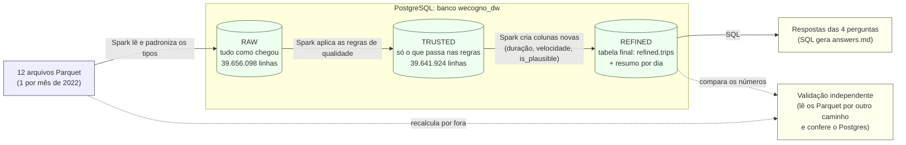
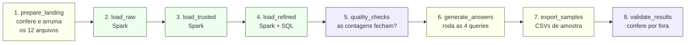

# WeCogno Data Engineering Challenge — solução

ETL de corridas de táxi amarelo de Nova York (2022) com **Apache Airflow**, **PySpark** e
**PostgreSQL**, tudo orquestrado por Docker Compose e organizado em camadas
**raw → trusted → refined**.

Este repositório é um fork de
[datarisk-io/data-engineering-challenge](https://github.com/datarisk-io/data-engineering-challenge);
conforme o enunciado, o código e a documentação ficam no diretório `challenge/`.

> **Status de validação:** o pipeline foi executado ponta a ponta no GitHub Actions (workflow
> `Run ETL`, modo `airflow_dag`, duas execuções seguidas): as 8 tarefas da DAG terminaram em
> sucesso, a validação independente fechou **65 de 65 checagens** e as contagens não mudaram na
> segunda execução (a carga não duplica). Detalhes em [Como validar](#como-validar).

## Arquitetura

**Em uma frase:** os 12 arquivos mensais entram, passam por três etapas de "arrumação" (camadas
raw, trusted e refined) dentro de um banco PostgreSQL, e no fim as 4 perguntas são respondidas
com SQL. O Airflow é o "gerente" que manda cada etapa rodar na ordem certa, e o Spark é o
"operário" que faz o trabalho pesado de ler e transformar 39,6 milhões de linhas.

### 1. O caminho do dado



Setas cheias são o caminho do dado; setas pontilhadas são a conferência feita por fora.

| Camada | Em linguagem simples | O que entra | Linhas |
|---|---|---|---|
| **raw** | A "caixa de entrada": guarda tudo exatamente como veio, só com os tipos padronizados. Nada é jogado fora | Os 12 arquivos | 39.656.098 |
| **trusted** | A "triagem": só fica o que faz sentido (horários existem, a corrida termina depois de começar, é de 2022, distância não negativa) | A raw, menos 14.174 linhas descartadas (0,036%) | 39.641.924 |
| **refined** | A "prateleira pronta": mesmas linhas da trusted, com colunas calculadas (duração, velocidade média, data, `is_plausible`) e um resumo por dia | A trusted | 39.641.924 |

**Exemplo: o que acontece com 4 corridas diferentes**

| Corrida | raw | trusted | refined |
|---|---|---|---|
| Normal (2 milhas, 12 minutos, em junho de 2022) | entra | entra | entra, `is_plausible = true` |
| Início com data de 2002 (erro do taxímetro) | entra | **fica de fora** (não é de 2022) | não existe |
| Termina antes de começar | entra | **fica de fora** (duração negativa) | não existe |
| 389.678 milhas em 13 minutos | entra | entra (distância não é negativa) | entra, mas `is_plausible = false` |

### 2. A ordem de execução (o que o Airflow comanda)



Verde: carga com Spark. Azul: conferências. Amarelo: preparação e saídas. É uma fila reta porque
cada etapa depende da anterior. DAG `wecogno_nyc_taxi_etl` (disparo manual):

| Tarefa | O que faz |
|---|---|
| `prepare_landing` | Garante os 12 arquivos mensais (baixa os que faltarem) e normaliza os nomes |
| `load_raw` | PySpark lê os parquets e grava `raw.yellow_tripdata`, sem descartar nada |
| `load_trusted` | PySpark aplica as regras de qualidade e grava `trusted.yellow_tripdata` |
| `load_refined` | PySpark enriquece e grava `refined.trips`; SQL monta `refined.daily_summary` |
| `quality_checks` | Reconcilia contagens entre camadas e gera `outputs/data_quality.md` |
| `generate_answers` | Executa `sql/queries/*.sql` e gera `outputs/answers.md` com as tabelas |
| `export_samples` | Exporta CSVs de amostra para `outputs/samples/` |
| `validate_results` | Recalcula as métricas direto dos Parquet e compara com o Postgres |

### 3. Quem faz o quê

| Peça | Papel (analogia) | Por que está aqui |
|---|---|---|
| **Airflow** | O gerente: decide a ordem, repete uma tarefa que falhou, registra o que rodou | Orquestração pedida no desafio |
| **PySpark** | O operário: lê e transforma milhões de linhas em paralelo | Volume grande; escala se crescer |
| **PostgreSQL (warehouse)** | O armazém: guarda as três camadas e responde as consultas SQL | Pedido no desafio |
| **PostgreSQL (do Airflow)** | O caderno do gerente: só guarda o histórico das execuções | Separado para não misturar com os dados |
| **Docker Compose** | A caixa que sobe tudo junto, igual em qualquer computador | Reprodutibilidade |
| **GitHub Actions** | Um computador temporário na nuvem, usado para rodar e provar que funciona | Eu não tinha Docker local |
| **PyArrow + NumPy** | O auditor: refaz as contas por outro caminho para conferir o resultado | Validação independente |

## Glossário rápido

| Termo | O que é |
|---|---|
| **ETL** | Extrair (ler a fonte), Transformar (limpar e calcular) e Carregar (gravar no destino). É o que o pipeline faz do começo ao fim |
| **Parquet** | Formato de arquivo para dados em colunas, compacto e rápido de ler. Os 12 arquivos de entrada são Parquet (apesar do `.gz` no nome) |
| **`tpep_pickup_datetime`** (pickup) | Data e hora em que o passageiro **embarcou**, ou seja, o início da corrida. É a coluna usada para dizer "em que dia a viagem começou" e para particionar as tabelas |
| **`tpep_dropoff_datetime`** (dropoff) | Data e hora em que o passageiro **desembarcou**, ou seja, o fim da corrida. Junto com o pickup dá a duração |
| **`trip_distance`** | Distância da corrida, em milhas, medida pelo taxímetro. Base das perguntas 3 e 4 |
| **`trip_date`** | Data do início da corrida (só o dia), calculada a partir do pickup |
| **`trip_duration_min`** | Duração em minutos: dropoff menos pickup |
| **`avg_speed_mph`** | Velocidade média em milhas por hora: distância dividida pela duração |
| **`is_plausible`** | Marca "verdadeiro" quando a corrida é fisicamente possível (duração entre 0 e 24 h e velocidade de até 100 mph). Não apaga nada: só sinaliza as suspeitas |
| **`refined.daily_summary`** | Uma linha por dia (365 no total) com quantas corridas começaram, quantas começaram e terminaram no mesmo dia, distância total e média e valor total. É um resumo pronto para consultar |
| **Valor fora do padrão (outlier)** | Valor muito distante do normal, como a corrida de 389.678 milhas. Distorce médias e desvio padrão |
| **Partição** | Divisão de uma tabela grande em pedaços (aqui, um por mês de pickup). Consultas por data leem só os pedaços necessários |
| **Idempotente** | Rodar de novo dá o mesmo resultado, sem duplicar. Aqui, cada carga esvazia e recarrega a tabela |
| **Staging** | Tabela temporária onde o Spark grava primeiro. Só depois do sucesso o dado vai para a tabela final, então uma falha no meio não deixa a tabela quebrada |
| **DAG** | O "mapa" das tarefas do Airflow e da ordem entre elas |

## Estrutura

Os dados originais ficam em `nyc-tlc-data/` (raiz do fork) e toda a solução em `challenge/`:

```
challenge/
├── docker-compose.yml          # airflow-db, warehouse, airflow-init/webserver/scheduler
├── docker/airflow/             # Dockerfile (Airflow + Java 17 + PySpark + driver JDBC)
├── dags/                       # DAG do Airflow
├── etl/                        # código do ETL
│   ├── config.py               # configuração via variáveis de ambiente
│   ├── schema.py               # schema canônico da camada raw
│   ├── spark_utils.py          # SparkSession e leitura/escrita JDBC
│   ├── landing.py              # preparação dos arquivos de entrada
│   ├── jobs/                   # raw_load, trusted_load, refined_load (PySpark)
│   ├── quality.py              # checagens pós-carga
│   ├── answers.py              # execução das queries das perguntas
│   ├── export_samples.py       # CSVs de amostra (outputs/samples/)
│   ├── validate.py             # validação independente (Parquet x Postgres) + idempotência
│   ├── validate_dag.py         # confere import e estrutura da DAG sem executá-la
│   └── cli.py                  # roda etapas fora do Airflow (python -m etl.cli <etapa>)
├── scripts/run_direct.sh       # pipeline completo sem Airflow
├── tests/test_validate_core.py # teste do núcleo da validação com dados sintéticos
├── sql/
│   ├── init/                   # DDL dos schemas, tabelas e partições (roda na criação do warehouse)
│   ├── tests/                  # partition_smoke.sql: teste rápido do particionamento (CI)
│   ├── transform/              # SQL de transformação (resumo diário)
│   └── queries/                # queries das 4 perguntas
├── data/                       # área de trabalho da DAG (não versionada) — veja data/README.md
└── outputs/                    # answers.md, data_quality.md, validation.md, samples/*.csv
```

## Como executar

Requisitos: Docker com Docker Compose, ~6 GB de RAM liberados para o Docker e ~20 GB de
disco livre (são ~40 milhões de linhas em três camadas).

1. **Dados.** Nada a fazer: os 12 arquivos já estão no fork, em `nyc-tlc-data/`, e a DAG
   lê de lá. Se algum mês faltar, a primeira tarefa baixa do repositório original.
2. **(Linux)** dentro de `challenge/`, evite problemas de permissão nas pastas montadas:
   `echo "AIRFLOW_UID=$(id -u)" > .env`
3. **Subir o ambiente** (a partir de `challenge/`):
   ```bash
   cd challenge
   docker compose build
   docker compose up airflow-init
   docker compose up -d
   ```
4. **Disparar a DAG** pela interface (<http://localhost:8080>, usuário e senha `admin`) ou por:
   ```bash
   docker compose exec airflow-scheduler airflow dags trigger wecogno_nyc_taxi_etl
   ```
5. **Resultados:** ao final, veja `outputs/answers.md` (tabelas das 4 perguntas) e
   `outputs/data_quality.md`.
6. **Consultar o banco** (opcional):
   ```bash
   docker compose exec warehouse psql -U wecogno -d wecogno_dw
   ```
   ou, de fora do Docker, `localhost:5433` (banco `wecogno_dw`, usuário/senha `wecogno`).

Para recomeçar do zero (apaga os bancos): `docker compose down -v`. Se você já tinha um volume
criado antes do particionamento, use esse comando: o DDL só roda na criação do volume.

## Executar pelo GitHub Actions (sem Docker local)

O workflow `.github/workflows/run-etl.yml` roda o pipeline no runner do GitHub, com um
PostgreSQL como serviço, Airflow e PySpark instalados via pip. Não precisa de Docker na sua
máquina.

1. No GitHub, abra a aba **Actions** do fork. Se aparecer o aviso de workflows desativados em
   forks, clique em **I understand my workflows, go ahead and enable them**.
2. Escolha o workflow **Run ETL (Airflow + PySpark + PostgreSQL)** → **Run workflow**.
3. Modo de execução:
   - `airflow_dag` (padrão): executa a DAG `wecogno_nyc_taxi_etl` com `airflow dags test`;
   - `direct_jobs`: executa os mesmos passos direto em Python (mais simples de depurar).
   - `run_twice` (opcional): roda o pipeline duas vezes e confere que as contagens não mudaram
     (prova de que a carga é idempotente; dobra o tempo).
4. Ao terminar, as tabelas das 4 perguntas aparecem no **resumo da execução** (aba Summary) e os
   arquivos `answers.md`, `data_quality.md`, `validation.md` e os CSVs de `samples/` ficam no
   artefato `etl-results`.

O banco do CI é descartável: ele roda com `fsync` desligado para acelerar a carga. A execução
leva em torno de uma hora, dependendo do runner.

## Como validar

A DAG termina com duas tarefas de verificação, além das checagens de contagem entre camadas:

- **`export_samples`**: grava CSVs em `outputs/samples/` (resumo diário, amostras de raw, trusted e
  refined, linhas rejeitadas pela trusted, as 20 viagens mais longas e viagens implausíveis), para
  inspecionar os dados sem cliente SQL.
- **`validate_results`** (`etl/validate.py`): recalcula, **sem Spark e sem Postgres**, direto dos 12
  Parquet (PyArrow + NumPy), as contagens por mês da raw (rodapé dos arquivos), as linhas da
  trusted/refined, as linhas de cada partição (12 meses e `DEFAULT`), as viagens plausíveis, a Q2, a Q3 (distância e dia) e a Q4 (média, desvio, mínimo,
  máximo e quartis), e compara com o que o pipeline gravou. Cada checagem vira uma linha de
  `outputs/validation.md` e qualquer divergência faz a tarefa falhar.

Outras verificações:

- **Estrutura da DAG** sem executar: `python -m etl.validate_dag` (o workflow roda isso antes da
  carga e imprime `airflow tasks list wecogno_nyc_taxi_etl --tree`).
- **Idempotência**: execute o workflow com `run_twice` marcado; `outputs/idempotency.md` compara as
  contagens após a 1ª e a 2ª execução.
- **Núcleo da validação**: `cd challenge && PYTHONPATH=. python tests/test_validate_core.py`
  compara o cálculo em NumPy com um cálculo linha a linha em Python puro, em dados sintéticos com
  nulos, datas invertidas, distâncias negativas e valores fora do padrão.
- **Reproduzir uma resposta à mão** no Postgres local: veja `sql/queries/` e rode no `psql`.

### Resultado da validação (execução do workflow com `run_twice`, após o particionamento)

- **Estrutura da DAG:** OK (8 tarefas, ordem `prepare_landing >> load_raw >> load_trusted >> load_refined >> quality_checks >> generate_answers >> export_samples >> validate_results`).
- **Teste do particionamento:** OK (roteamento para a partição certa, `DEFAULT` para pickup nulo ou fora de 2022, `TRUNCATE` do pai e troca via staging).
- **Validação independente:** **65 de 65 checagens OK** nas duas execuções. Raw por mês e total (39.656.098), linhas por partição (12 meses e `DEFAULT`) na raw e na trusted, trusted e refined (39.641.924), Q2, Q3 e Q4 recalculados direto dos Parquet batem com o Postgres.
- **Idempotência:** após a 2ª execução as contagens não mudaram.

| tabela | 1ª execução | 2ª execução | status |
| --- | ---: | ---: | --- |
| raw.yellow_tripdata | 39.656.098 | 39.656.098 | OK |
| trusted.yellow_tripdata | 39.641.924 | 39.641.924 | OK |
| refined.trips | 39.641.924 | 39.641.924 | OK |
| refined.daily_summary | 365 | 365 | OK |

A validação confere o pipeline contra a mesma regra de negócio escrita de forma independente; ela
não decide se as regras da trusted são as certas (isso está explicado em "Decisões tomadas").

## Decisões tomadas

- **PySpark em modo local** dentro do container do Airflow, chamado por `BashOperator`
  (uma JVM por tarefa, isolada do scheduler). Com ~40 M de linhas, Spark dá paralelismo na
  leitura e na escrita sem exigir um cluster.
- **Dois PostgreSQL separados:** um para metadados do Airflow e outro para o warehouse.
- **Camadas em schemas distintos** (`raw`, `trusted`, `refined`), com DDL explícito em
  `sql/init`. As cargas usam **staging e troca atômica**: o Spark
  grava em `<tabela>_staging`; só depois do sucesso uma transação faz `TRUNCATE` da tabela final
  e `INSERT ... SELECT` da staging. Se o job falhar no meio, a tabela final continua como estava
  (a transação nem começou). O resumo diário é refeito com `TRUNCATE` + `INSERT ... SELECT`.
  Nada é acrescentado em cima do que já existia, então rodar a DAG de novo **não duplica** os
  dados (carga idempotente).
- **Tabelas particionadas por mês** de `tpep_pickup_datetime` (`raw`, `trusted` e `refined.trips`):
  12 partições de 2022 mais uma `DEFAULT`, que recebe pickup nulo ou fora de 2022 (a raw tem
  timestamps de 2002, 2008 etc.) e fica vazia na trusted e na refined. Particionei pela própria
  coluna de data do evento, e não por colunas `ano`/`mes` extras, para que filtros pelo horário
  da viagem (como a Q2) leiam só as partições necessárias. Por que não pelo `overwrite` do Spark:
  ele emite `TRUNCATE TABLE ONLY`, que o Postgres recusa em tabela particionada, então o
  `TRUNCATE` é feito em SQL, dentro da troca atômica. Nesta versão a carga ainda é total; a evolução
  natural é refazer só a partição do mês (carga incremental).
- **Arquivos já são Parquet:** apesar do `.gz`, a compressão é interna; não há descompactação.
- **Schema canônico por arquivo:** os meses têm tipos inconsistentes (`passenger_count`,
  `RatecodeID`, caixa de `airport_fee`). Cada arquivo é lido sozinho, convertido para o schema
  canônico (`etl/schema.py`) e só então unido.
- **Fuso em UTC** no Spark e na JVM: os horários das corridas são "relógio de parede" e não
  podem ser deslocados na gravação.
- **Valores monetários em `numeric(12,2)`**, distância em `double precision`.
- **Leitura paralela via JDBC** particionada por `file_month` (1 a 12). O Spark usa 11 partições de
  leitura (o mês 12 cai junto na última), o que não perde linhas; só reduz um pouco o paralelismo.
- **Resumo diário em SQL** (ELT dentro do Postgres), por ser uma agregação simples sobre a
  tabela final.

### Regras da camada trusted

Um registro só passa se atender a **todas** as condições:

1. `tpep_pickup_datetime` e `tpep_dropoff_datetime` não nulos;
2. `dropoff >= pickup`;
3. `pickup` dentro de 2022 (a fonte tem timestamps de 2002, 2008, 2021, 2023...);
4. `trip_distance` não nulo e `>= 0`.

Não há deduplicação: a fonte não tem chave natural e remover linhas idênticas poderia
descartar corridas legítimas. Quantos registros cada regra descarta fica em
`outputs/data_quality.md`.

### Camada refined e a coluna `is_plausible`

`refined.trips` é a **tabela final**: tem as mesmas linhas da trusted, mais `trip_date`,
`dropoff_date`, `trip_duration_min`, `avg_speed_mph` e `is_plausible`.

`is_plausible` marca viagens com duração entre 0 e 24 h e velocidade média de até 100 mph.
Ela **não remove** linhas: serve para analisar distâncias com e sem valores fora do padrão (o dado de táxi
de NY costuma ter viagens de milhares de milhas em poucos minutos, que são erros de
medição). Por isso as perguntas 3 e 4 trazem **duas linhas**: todas as viagens e somente as
plausíveis.

### Interpretação das perguntas

- **Q1:** "tabela final" = `refined.trips`; a query também mostra a contagem de cada camada.
- **Q2:** retorna três números: viagens iniciadas no dia, finalizadas no dia e as que
  começaram **e** terminaram em 17/06/2022 (a leitura mais literal do enunciado).
- **Q3:** "mais longa" = maior `trip_distance`; o "dia" é o da data de início da viagem (a
  de término também é exibida).
- **Q4:** desvio padrão amostral (`stddev_samp`) e quartis por interpolação
  (`percentile_cont`).

## Respostas

Resumo (valores da execução no GitHub Actions):

| # | Pergunta | Resposta |
|---|---|---|
| 1 | Total de registros na tabela final | **39.641.924** |
| 2 | Viagens iniciadas e finalizadas em 17/06/2022 | **123.834** começaram e terminaram no dia (125.586 iniciadas; 125.342 finalizadas) |
| 3 | Dia da viagem mais longa | **2022-10-28** (389.678,46 milhas, dado claramente inválido); entre as plausíveis, **2022-06-13** (380,13 milhas) |
| 4 | Distribuição da distância | média 5,9594, desvio padrão 599,2978, mín. 0, máx. 389.678,46; quartis 1,10 / 1,90 / 3,56 |

Da raw (39.656.098 linhas) para a trusted foram descartados 14.174 registros (0,036%). Na
refined, 65.538 viagens (0,17%) ficam com `is_plausible = false`.

As queries abaixo são exatamente as de `sql/queries/`.

**Sobre o valor fora do padrão (outlier) da Q3 e da Q4:** a viagem de 389.678,46 milhas durou 13 minutos, o que dá
uma velocidade média de cerca de 1,8 milhão de mph: é erro de medição na fonte, não uma viagem
real. Por isso as duas perguntas trazem também a leitura apenas com as viagens plausíveis
(duração de até 24 h e velocidade média de até 100 mph). Nessa leitura, o desvio padrão cai de
599,30 para 4,48 e a média de 5,96 para 3,50 milhas.

### 1. Qual o total de registros na tabela final?

```sql
SELECT 'raw.yellow_tripdata'     AS tabela, count(*) AS registros FROM raw.yellow_tripdata
UNION ALL
SELECT 'trusted.yellow_tripdata' AS tabela, count(*) AS registros FROM trusted.yellow_tripdata
UNION ALL
SELECT 'refined.trips (final)'   AS tabela, count(*) AS registros FROM refined.trips;
```

| tabela | registros |
|---|---|
| raw.yellow_tripdata | 39656098 |
| trusted.yellow_tripdata | 39641924 |
| refined.trips (final) | 39641924 |

### 2. Total de viagens iniciadas e finalizadas no dia 17 de junho

```sql
SELECT
    count(*) FILTER (
        WHERE tpep_pickup_datetime >= DATE '2022-06-17'
          AND tpep_pickup_datetime <  DATE '2022-06-18'
    ) AS viagens_iniciadas,
    count(*) FILTER (
        WHERE tpep_dropoff_datetime >= DATE '2022-06-17'
          AND tpep_dropoff_datetime <  DATE '2022-06-18'
    ) AS viagens_finalizadas,
    count(*) FILTER (
        WHERE tpep_pickup_datetime  >= DATE '2022-06-17'
          AND tpep_pickup_datetime  <  DATE '2022-06-18'
          AND tpep_dropoff_datetime >= DATE '2022-06-17'
          AND tpep_dropoff_datetime <  DATE '2022-06-18'
    ) AS iniciadas_e_finalizadas_no_dia
FROM refined.trips
WHERE tpep_pickup_datetime  <  DATE '2022-06-18'
  AND tpep_dropoff_datetime >= DATE '2022-06-17';
```

| viagens_iniciadas | viagens_finalizadas | iniciadas_e_finalizadas_no_dia |
|---|---|---|
| 125586 | 125342 | 123834 |

### 3. Qual foi o dia da viagem mais longa percorrida?

```sql
(
    SELECT
        'todas as viagens (trusted)'            AS base,
        trip_date                               AS dia_da_viagem,
        trip_distance                           AS distancia_milhas,
        tpep_pickup_datetime                    AS inicio,
        tpep_dropoff_datetime                   AS fim,
        round(trip_duration_min::numeric, 1)    AS duracao_min,
        round(avg_speed_mph::numeric, 1)        AS velocidade_media_mph
    FROM refined.trips
    ORDER BY trip_distance DESC, tpep_pickup_datetime
    LIMIT 1
)
UNION ALL
(
    SELECT
        'somente viagens plausiveis',
        trip_date,
        trip_distance,
        tpep_pickup_datetime,
        tpep_dropoff_datetime,
        round(trip_duration_min::numeric, 1),
        round(avg_speed_mph::numeric, 1)
    FROM refined.trips
    WHERE is_plausible
    ORDER BY trip_distance DESC, tpep_pickup_datetime
    LIMIT 1
);
```

| base | dia_da_viagem | distancia_milhas | inicio | fim | duracao_min | velocidade_media_mph |
|---|---|---|---|---|---|---|
| todas as viagens (trusted) | 2022-10-28 | 389678.46 | 2022-10-28 05:19:00 | 2022-10-28 05:32:00 | 13.0 | 1798516.0 |
| somente viagens plausiveis | 2022-06-13 | 380.13 | 2022-06-13 01:36:18 | 2022-06-13 08:21:44 | 405.4 | 56.3 |

### 4. Distribuição da distância percorrida

```sql
SELECT
    'todas as viagens (trusted)'                                                           AS base,
    count(*)                                                                               AS viagens,
    round(avg(trip_distance)::numeric, 4)                                                  AS media,
    round(stddev_samp(trip_distance)::numeric, 4)                                          AS desvio_padrao,
    min(trip_distance)                                                                     AS minimo,
    round((percentile_cont(0.25) WITHIN GROUP (ORDER BY trip_distance))::numeric, 4)       AS q1_25,
    round((percentile_cont(0.50) WITHIN GROUP (ORDER BY trip_distance))::numeric, 4)       AS mediana_50,
    round((percentile_cont(0.75) WITHIN GROUP (ORDER BY trip_distance))::numeric, 4)       AS q3_75,
    max(trip_distance)                                                                     AS maximo
FROM refined.trips
UNION ALL
SELECT
    'somente viagens plausiveis',
    count(*),
    round(avg(trip_distance)::numeric, 4),
    round(stddev_samp(trip_distance)::numeric, 4),
    min(trip_distance),
    round((percentile_cont(0.25) WITHIN GROUP (ORDER BY trip_distance))::numeric, 4),
    round((percentile_cont(0.50) WITHIN GROUP (ORDER BY trip_distance))::numeric, 4),
    round((percentile_cont(0.75) WITHIN GROUP (ORDER BY trip_distance))::numeric, 4),
    max(trip_distance)
FROM refined.trips
WHERE is_plausible;
```

| base | viagens | media | desvio_padrao | minimo | q1_25 | mediana_50 | q3_75 | maximo |
|---|---|---|---|---|---|---|---|---|
| todas as viagens (trusted) | 39641924 | 5.9594 | 599.2978 | 0 | 1.1000 | 1.9000 | 3.5600 | 389678.46 |
| somente viagens plausiveis | 39576386 | 3.5017 | 4.4785 | 0 | 1.1000 | 1.9000 | 3.5500 | 380.13 |

## Solução de problemas

- **Tarefa `load_*` morrendo por memória:** aumente a memória do Docker e/ou
  `SPARK_DRIVER_MEMORY` (padrão `3g`) e reduza `SPARK_LOCAL_CORES` (padrão `4`) no `.env`.
- **Erro de permissão em `data/`, `logs/` ou `outputs/` (Linux):** defina `AIRFLOW_UID`
  (passo 2) e suba de novo.
- **Mudou o DDL em `sql/init`:** os scripts só rodam quando o volume do warehouse é criado;
  use `docker compose down -v` para recriar.
- **`prepare_landing` tentando baixar arquivos:** confirme que `nyc-tlc-data/` tem os 12
  `yellow_tripdata_2022-XX.parquet.gz` (um clone incompleto pode ter deixado arquivos de fora).
